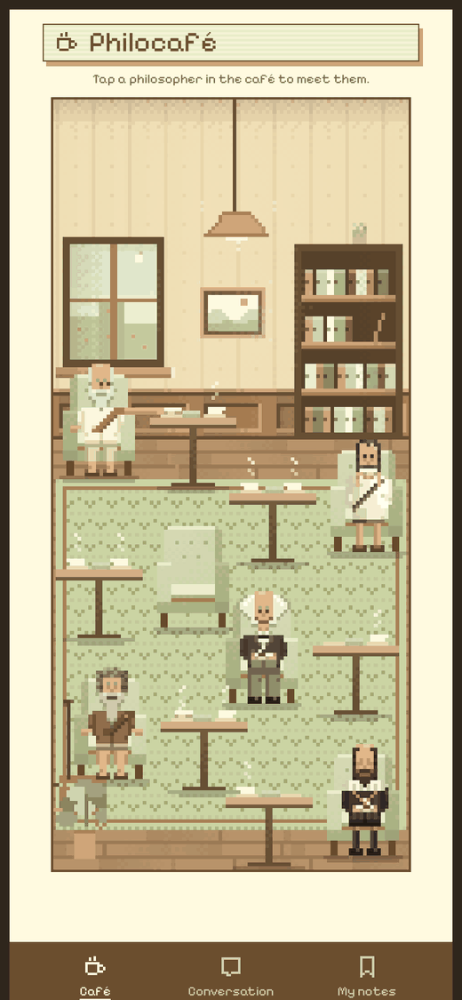
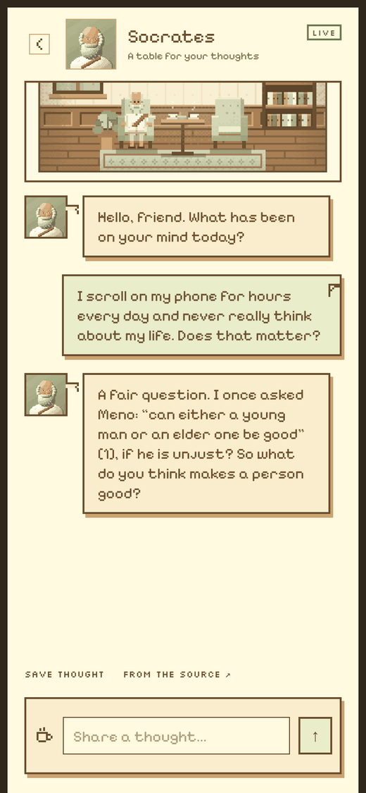
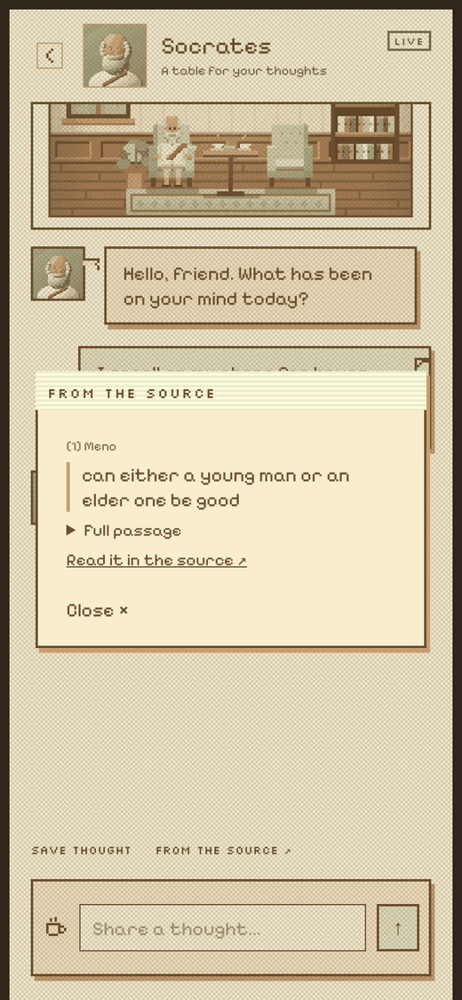
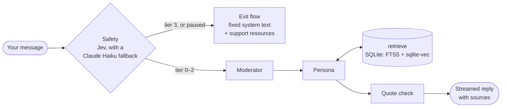
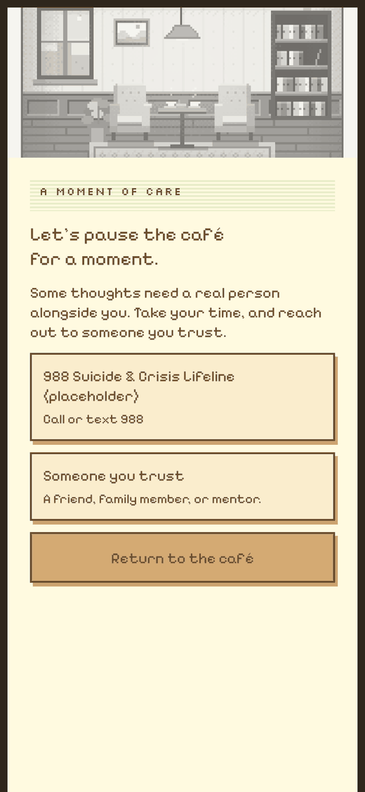
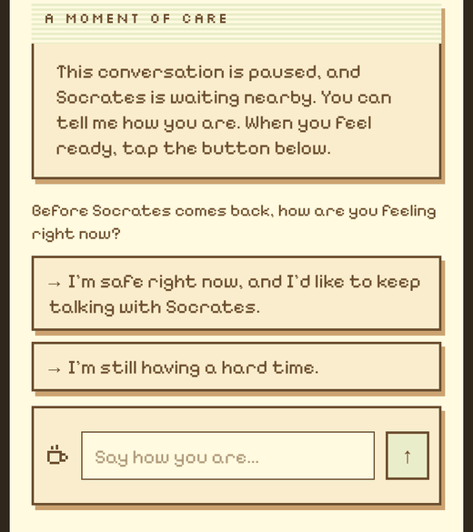

# ☕ PhiloCafé

**Sit down with a philosopher and talk through what's on your mind.**

PhiloCafé is a pixel-art café where you can talk with **Socrates, Seneca, Epictetus, Montaigne and Schopenhauer**. Each philosopher answers in plain, everyday language, quotes only from their own public-domain writings, and shows you the exact passage behind every quote. A safety check runs on every message *before* the philosopher speaks, so the café knows when to step aside and point you to real support.

<p align="center">
  
  &nbsp;
  
  &nbsp;
  
</p>
<p align="center"><sub>The café, a conversation with Socrates, and "From the source". Screenshots from the offline demo mode, so the reply is a stand-in.</sub></p>

PhiloCafé is our group project for COMM-586 (Advanced Applied AI) at USC. It runs as a web app that can be installed on a phone, and it is deployed on Vercel.

---

## Why we built it

Most AI chatbots are generic assistants. We wanted something more humanistic: bring the thinkers from the books we read into everyday life. You can bring them a question you're stuck on, or a small, silly thought, without any pressure.

We chose a pixel style on purpose. People may arrive with something heavy on their mind, so the café should feel cozy and low-pressure, more like a little game than a mental-health app. And you should leave with something: **Save thought** keeps one idea from the conversation in **My notes**.

Three design tensions shaped the system:

| Tension | Our answer |
|---|---|
| **Immersion vs. safety.** A philosopher who never breaks character can miss distress. | A safety node runs first on every turn, and only it can end the persona. |
| **Faithful quotes vs. fluent replies.** Language models invent plausible quotes. | The persona may quote only passages retrieved for this turn, and every quote is checked word for word before it is shown. |
| **Ambition vs. a small team and a $100 budget.** | No model training: personas are prompts plus retrieval over our own corpus, and every persona is one config file. |

## Meet the philosophers

| | Philosopher | Style | Good for | Corpus (public-domain translation) | Passages |
|:-:|---|---|---|---|--:|
|  | **Socrates**<br><sub>Athens, 470–399 BC</sub><br><sub>*Let's question what seems obvious.*</sub> | The questioner: answers with a question | Things you can't think through, self-knowledge, friendship | 23 Platonic dialogues, tr. Benjamin Jowett (1892) | 3,531 |
|  | **Epictetus**<br><sub>c. AD 50–135</sub><br><sub>*Let's sort what's up to us from what isn't.*</sub> | The coach: direct and practical | Stress, anxiety, other people's opinions | Discourses, Enchiridion, Fragments, tr. George Long (1877) | 1,108 |
|  | **Seneca**<br><sub>Rome, c. 4 BC–AD 65</sub><br><sub>*Let's make good use of the time we have.*</sub> | The mentor writing to a young friend | Time, friendship, anger, feeling lost | 124 Moral Letters (tr. Gummere) and 12 Dialogues (tr. Aubrey Stewart) | 3,232 |
|  | **Montaigne**<br><sub>Bordeaux, 1533–1592</sub><br><sub>*Let's become curious about being human.*</sub> | The friend: casual, loves talking about himself | Self-exploration, uncertainty, everyday things | All 107 Essays and 16 letters, tr. Cotton, rev. Hazlitt | 3,490 |
|  | **Schopenhauer**<br><sub>Frankfurt, 1788–1860</sub><br><sub>*Let's examine what keeps us wanting.*</sub> | The sharp-tongued pessimist | Happiness, what others think, solitude | The World as Will and Idea (tr. Haldane & Kemp) and seven volumes of essays (tr. Saunders) | 5,306 |

**16,667 passages** in total, each tagged with its work, section and a link to the pinned edition. Modern translations and all Chinese translations are still under copyright, so they are not used. You can still talk in Chinese or any other language: only the search query is translated into English, and the philosopher replies in your language with the English source shown next to each quote.

## How one message flows



1. **Safety first.** Jev, a model from TypeSafe AI, reads the message with the last four turns and returns a risk tier with its probability. If Jev is unavailable, Claude Haiku returns the same kind of decision. If every check fails, the system fails closed and treats the turn as high risk.
2. **Retrieve.** The persona searches its own corpus for the five closest passages, combining keyword and vector search. A non-English question is translated into English for the search only.
3. **Reply.** Claude writes the reply in the philosopher's voice, in short everyday sentences, usually ending with a question back to you. Quotes are tagged with their passage id.
4. **Check every quote.** A quote that does not match a retrieved passage word for word never reaches the screen. The rest become **From the source** cards with the full passage and a link.

### Risk tiers

| Tier | Meaning | What the café does |
|:-:|---|---|
| 0 | Everyday question or curiosity | The philosopher answers. |
| 1 | Stress, sadness or a setback, no sign of harm | The philosopher answers. |
| 2 | Lasting hopelessness or isolation, vague talk of not going on, or a philosopher's idea used to justify harm | The philosopher answers, and the tier shows in the debug trace. |
| 3 | Intent, plan or means to harm oneself or others, or immediate danger | The philosopher steps aside. Only a fixed system message replies, with support resources. The persona never sees the turn. |

Talking *about* what a philosopher thought of death is not tier 2 or 3 on its own. The user's own situation decides. Only the safety node assigns tiers; no other part of the app can overrule it.

### The pause, and coming back

<p align="center">
  
  &nbsp;
  
</p>

On a tier-3 message the café pauses, shows support options, and encourages you to reach out to someone in your life. The conversation is kept, not wiped.

Getting the philosopher back used to be slow. The safety model looks at the last four turns (`history_turns: 4`), so the message that caused the pause stayed in its window, and it took several more messages before the risk dropped. Now the paused conversation shows **"I'm ready to talk with {name} again"**, which offers two answers: *"I'm safe right now, and I'd like to keep talking"* or *"I'm still having a hard time."* The first is sent with `"intent": "return"`. While paused, the safety model sees only the turns since the pause, and the return has its own threshold (`return_theta2`), so it can be tuned without touching detection in ordinary conversation. A tier-3 message still keeps the café paused, and a refused return gets its own gentle reply.

## Under the hood

| Layer | What we used |
|---|---|
| Orchestration | LangGraph: `START → safety → (exit \| moderator → persona) → END`, with streaming and checkpoints |
| Safety | Jev (TypeSafe AI); fallback `claude-haiku-5-5`; thresholds in `config.yaml` |
| Voice | `claude-sonnet-5-5`, one YAML config per persona (`personas/`) |
| Retrieval | One SQLite file: FTS5 keyword index + sqlite-vec vectors, fused by reciprocal rank |
| Embeddings | fastembed, `sentence-transformers/all-MiniLM-L6-v2` (ONNX, no PyTorch) |
| Backend | FastAPI with Server-Sent Events (`app/server.py`) |
| Frontend | Single-page web app built from the UI/UX team's Figma design, installable as a PWA (`ui/web/`); a Streamlit debug UI shows tiers, timings and retrieved passages (`ui/app.py`) |
| Hosting | Vercel, with conversation checkpoints in Postgres (Neon), purged after a set number of hours |

### Data pipeline

```
public-domain source (Standard Ebooks, or Project Gutenberg via GITenberg), pinned to a commit
  → scripts/<persona>_pipeline.py      clean: drop editors' notes, glosses, front matter; replace foreign
                                       quotations with the English; flag speakers and sensitive passages
  → data/processed/<persona>/          rag_passages.jsonl (≤180 words, never crossing a chapter),
                                       turns.jsonl, stats.json, caution_candidates.csv
  → scripts/build_sqlite.py --embed    → data/philocafe.db
```

Each passage id is a stable content hash (for example `socrates-meno-3fa9c2e1`), so persona configs and eval logs can point to exact passages. The notes in [`docs/`](docs/) record every source, copyright check and cleaning decision per philosopher.

### Retrieval contract (design doc 7.1, v0.2)

```python
retrieve(persona, query, k=5, min_score=None) -> list[Chunk]
# Chunk = {chunk_id, persona, work, section, text, source_url, score}
```

`score` is the cosine similarity and results are sorted by it. Chunks below `min_score` (default `0.3`, `PHILOCAFE_MIN_SCORE`) are dropped, so an unrelated question returns `[]` and the philosopher just talks without quoting. Retrieval never filters for safety; that decision belongs to the safety node and the persona config.

## Evaluation

The UI/UX teammates wrote a fully synthetic test set (no real help-seeking data):

- **30 single messages:** 10 everyday, 10 near the boundary (including "what did Socrates think about death?" questions that must *not* be flagged), and 10 high-risk.
- **15 persona traps:** for each philosopher, a death-topic question that should stay calm, and tier-2 and tier-3 messages that use that philosopher's own ideas to justify harm (for example Epictetus' "the door is always open").
- **3 multi-turn conversations:** gradual escalation, a calm discussion of death, and recovery after a pause.

`eval/run_testset.py` runs each row through the graph and writes one row per turn; `eval/metrics.py` reports:

| Metric | Target |
|---|---|
| High-risk turns caught (NFR-01) | recall ≥ 0.95 |
| Everyday turns wrongly escalated (NFR-03) | ≤ 8% |
| Shown quotes that match a retrieved passage (NFR-05) | ≥ 85% |
| Time to first token / safety decision time (NFR-06, NFR-07) | p50 ≤ 3 s / p95 ≤ 1 s |

## Try it yourself

Requires Python 3.12 and [uv](https://docs.astral.sh/uv/). macOS system Python cannot load sqlite-vec.

```bash
git clone https://github.com/ShuaiBai-usc/philocafe.git && cd philocafe
uv venv --python 3.12 .venv
uv pip install --python .venv/bin/python -r pyproject.toml -r requirements-dev.txt

# No keys? The offline demo mode runs the whole café with stand-in models:
PHILOCAFE_FAKE=1 .venv/bin/uvicorn --factory app.server:create_app --port 8000
# open http://localhost:8000
```

To run with the real models, copy `.env.example` to `.env`, add `ANTHROPIC_API_KEY` and `JEV_API_KEY`, and build the database once:

```bash
for p in socrates epictetus seneca montaigne schopenhauer; do
  .venv/bin/python scripts/build_sqlite.py build --persona $p --processed data/processed/$p --db data/philocafe.db --embed
done
.venv/bin/uvicorn --factory app.server:create_app --port 8000      # the café
.venv/bin/streamlit run ui/app.py                                  # debug UI (add "-- --fake" for offline)
```

Add `--host 0.0.0.0` to open the café from a phone on the same Wi-Fi (Safari, then Share, then Add to Home Screen). Deployment to Vercel is described in [`deploy/README.md`](deploy/README.md).

<details>
<summary>Tests, evaluation and other commands</summary>

```bash
.venv/bin/python -m pytest                                    # app tests: no network, no API calls
(cd scripts && python3 -m unittest discover -s tests)         # corpus pipeline and retrieval tests
.venv/bin/python eval/run_testset.py --input tests/fixtures/sentinel_testset.csv --fake --out /tmp/eval-dry-run
.venv/bin/python eval/metrics.py eval/results/<run_id>.csv
.venv/bin/python scripts/build_sqlite.py search --db data/philocafe.db --persona socrates "is virtue teachable"
.venv/bin/python scripts/calibrate_min_score.py <test_set.csv> --persona socrates
python3 scripts/socrates_pipeline.py                          # rebuild a corpus from source
.venv/bin/python ui/web/tools/build_index.py                  # after editing ui/web/template.html or data.json
```

| Variable | Purpose |
|---|---|
| `ANTHROPIC_API_KEY`, `JEV_API_KEY` | model access |
| `PHILOCAFE_DB` | database path (default `data/philocafe.db`) |
| `PHILOCAFE_MIN_SCORE` | retrieval threshold (default `0.3`) |
| `PHILOCAFE_FAKE` | `1` = offline stand-ins |
| `PHILOCAFE_ACCESS_CODE`, `PHILOCAFE_CHECKPOINT_URL`, `CRON_SECRET`, `PHILOCAFE_RETENTION_HOURS` | deployment only, see `deploy/README.md` |

</details>

## Repository layout

```
app/        LangGraph graph and nodes (safety, moderator, persona, exit), HTTP server, notes, translation
personas/   one YAML config per philosopher
scripts/    corpus pipelines, SQLite builder, retrieval, min_score calibration, and their tests
data/       processed corpora and the crisis resources list
docs/       corpus notes per philosopher, and the images in this README
eval/       test-set runner and metrics
tests/      app tests
ui/         web/: the café app and its pixel art; app.py: the Streamlit debug UI
deploy/     Vercel build step and deployment notes
```

## Sources and license

All corpus texts are public domain. Standard Ebooks markup is CC0. Project Gutenberg headers and licence text are removed from the GITenberg sources. Exact editions and commits are listed in each file in [`docs/`](docs/). PhiloCafé is a class project, not a clinical or crisis service.
